# Recreate 101

[](https://github.com/marcelpetrick/codingWithGPT/actions/workflows/recreate-101.yml)
[](LICENSE)

Recreate an image repeatedly and watch the changes accumulate. Each generation uses only the previous image. The skill keeps the original, full-resolution PNG frames, a GIF, and a lineage record.

## Overview of all runs

Every run sends an image through a chain of generations. Each generation sees only the previous frame and one fixed prompt. The table shows each source, its latest frame and the drift `d` (ImageMagick SSIM distortion against the source, 0 = identical). It is generated from the run manifests by `updateComparison.sh`. Click a run for its frames, report and checkpoints. The image sources and licenses are in [examples/README.md](examples/README.md).

<!-- overview:start -->
| Run | Source | Latest frame | Model | Prompt | Generations | Status |
| --- | --- | --- | --- | --- | --- | --- |
| [Wirth, Codex, v1](pilot-niklaus-wirth/) |  | <br>gen 101, d = 0.466 · [GIF](pilot-niklaus-wirth/evolution.gif) | `codex-host-image-tool` | v1 | 101 / 101 | complete |
| [Wirth, ComfyUI, v1](pilot-comfyui-niklaus-wirth/) |  | 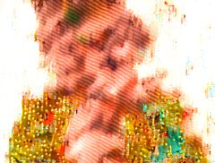<br>gen 100, d = 0.376 · [GIF](pilot-comfyui-niklaus-wirth/evolution.gif) | `comfyui-flux2-klein-4b-distilled` | v1 | 100 / 100 | complete |
| [Limburg, Codex, v1](pilot-limburg-cathedral/) |  | <br>gen 100, d = 0.463 · [GIF](pilot-limburg-cathedral/evolution.gif) | `codex-host-image-tool` | v1 | 100 / 100 | complete |
| [Limburg, ComfyUI, v1](pilot-comfyui-limburg-cathedral/) |  | 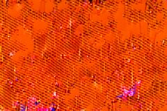<br>gen 100, d = 0.459 · [GIF](pilot-comfyui-limburg-cathedral/evolution.gif) | `comfyui-flux2-klein-4b-distilled` | v1 | 100 / 100 | complete |
| [Turing, Codex, v2](pilot-turing-codex-v2/) |  | 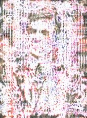<br>gen 100, d = 0.467 · [GIF](pilot-turing-codex-v2/evolution.gif) | `codex-host-image-tool` | prompt-v2 | 100 / 100 | complete |
| [Turing, ComfyUI, v2](pilot-comfyui-turing-v2/) |  | 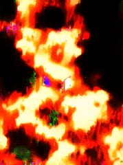<br>gen 100, d = 0.440 · [GIF](pilot-comfyui-turing-v2/evolution.gif) | `comfyui-flux2-klein-4b-distilled` | prompt-v2 | 100 / 100 | complete |
| [Turing, ComfyUI, v1](pilot-comfyui-turing-v1/) |  | 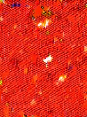<br>gen 100, d = 0.473 · [GIF](pilot-comfyui-turing-v1/evolution.gif) | `comfyui-flux2-klein-4b-distilled` | v1 | 100 / 100 | complete |
| [Cat, ComfyUI, v2](pilot-comfyui-tabby-cat/) |  | 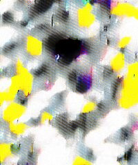<br>gen 100, d = 0.383 · [GIF](pilot-comfyui-tabby-cat/evolution.gif) | `comfyui-flux2-klein-4b-distilled` | prompt-v2 | 100 / 100 | complete |
| [Cat, ComfyUI, v3](pilot-comfyui-tabby-cat-v3/) | 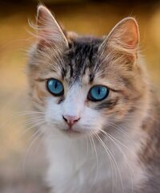 | <br>gen 100, d = 0.469 · [GIF](pilot-comfyui-tabby-cat-v3/evolution.gif) | `comfyui-flux2-klein-4b-distilled` | prompt-v3 | 100 / 100 | complete |
| [Cat, ComfyUI img2img, v3](pilot-comfyui-tabby-cat-v3i/) |  | 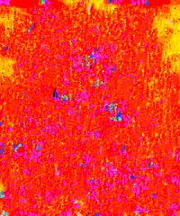<br>gen 100, d = 0.417 · [GIF](pilot-comfyui-tabby-cat-v3i/evolution.gif) | `comfyui-flux2-klein-4b-img2img-d0.25` | prompt-v3 | 100 / 100 | complete |
| [Corgi, ComfyUI, v2](pilot-comfyui-corgi-puppy/) |  | <br>gen 100, d = 0.448 · [GIF](pilot-comfyui-corgi-puppy/evolution.gif) | `comfyui-flux2-klein-4b-distilled` | prompt-v2 | 100 / 100 | complete |
| [Corgi, ComfyUI, v3](pilot-comfyui-corgi-puppy-v3/) |  | 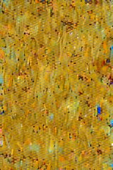<br>gen 100, d = 0.445 · [GIF](pilot-comfyui-corgi-puppy-v3/evolution.gif) | `comfyui-flux2-klein-4b-distilled` | prompt-v3 | 100 / 100 | complete |
| [Corgi, ComfyUI img2img, v3](pilot-comfyui-corgi-puppy-v3i/) |  | 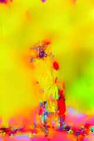<br>gen 0, d = 0.000 | `comfyui-flux2-klein-4b-img2img-d0.25` | prompt-v3 | 0 / 100 | running or queued |
| [Christmas market, ComfyUI, v2](pilot-comfyui-berlin-christmas-market/) |  | 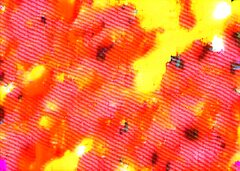<br>gen 100, d = 0.441 · [GIF](pilot-comfyui-berlin-christmas-market/evolution.gif) | `comfyui-flux2-klein-4b-distilled` | prompt-v2 | 100 / 100 | complete |
| [Christmas market, ComfyUI, v3](pilot-comfyui-berlin-christmas-market-v3/) |  | 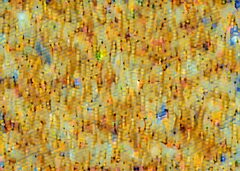<br>gen 100, d = 0.474 · [GIF](pilot-comfyui-berlin-christmas-market-v3/evolution.gif) | `comfyui-flux2-klein-4b-distilled` | prompt-v3 | 100 / 100 | complete |
| [Christmas market, ComfyUI img2img, v3](pilot-comfyui-berlin-christmas-market-v3i/) |  | <br>gen 0, d = 0.000 | `comfyui-flux2-klein-4b-img2img-d0.25` | prompt-v3 | 0 / 100 | running or queued |
| [Dwayne Johnson, ComfyUI, v2](pilot-comfyui-dwayne-johnson/) |  | <br>gen 100, d = 0.360 · [GIF](pilot-comfyui-dwayne-johnson/evolution.gif) | `comfyui-flux2-klein-4b-distilled` | prompt-v2 | 100 / 100 | complete |
| [Dwayne Johnson, ComfyUI, v3](pilot-comfyui-dwayne-johnson-v3/) |  | 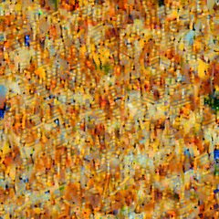<br>gen 100, d = 0.468 · [GIF](pilot-comfyui-dwayne-johnson-v3/evolution.gif) | `comfyui-flux2-klein-4b-distilled` | prompt-v3 | 100 / 100 | complete |
| [Dwayne Johnson, ComfyUI img2img, v3](pilot-comfyui-dwayne-johnson-v3i/) |  | <br>gen 0, d = 0.000 | `comfyui-flux2-klein-4b-img2img-d0.25` | prompt-v3 | 0 / 100 | running or queued |
| [Mona Lisa, ComfyUI, v2](pilot-comfyui-mona-lisa/) |  | <br>gen 100, d = 0.420 · [GIF](pilot-comfyui-mona-lisa/evolution.gif) | `comfyui-flux2-klein-4b-distilled` | prompt-v2 | 100 / 100 | complete |
| [Mona Lisa, ComfyUI, v3](pilot-comfyui-mona-lisa-v3/) |  | 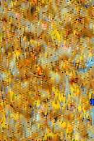<br>gen 100, d = 0.471 · [GIF](pilot-comfyui-mona-lisa-v3/evolution.gif) | `comfyui-flux2-klein-4b-distilled` | prompt-v3 | 100 / 100 | complete |
| [Mona Lisa, ComfyUI img2img, v3](pilot-comfyui-mona-lisa-v3i/) |  | 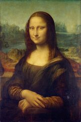<br>gen 0, d = 0.000 | `comfyui-flux2-klein-4b-img2img-d0.25` | prompt-v3 | 0 / 100 | running or queued |
| [Cat, ComfyUI img2img, v2 (control)](pilot-comfyui-tabby-cat-v2i/) |  | <br>gen 74, d = 0.422 · [GIF](pilot-comfyui-tabby-cat-v2i/evolution.gif) | `comfyui-flux2-klein-4b-img2img-d0.25` | prompt-v2 | 74 / 100 | running or queued |
<!-- overview:end -->

## Prompts

Each run stores its prompt in `manifest.json`. A run without a stored prompt uses v1 from `SKILL.md`.

- v1 asks for a faithful copy. It is the default.
- v2 also names color, contrast, sharpness and grain, to reduce drift. It gave a tie against v1 on ComfyUI (see [IMPLEMENTATION.md](IMPLEMENTATION.md)).
- v3 asks for a very small step toward an oil painting in each generation, to steer the drift into a style. On the default graph the model ignores "small" and paints the full style at once. The img2img runs use the same v3 text on a graph that limits each step.

<!-- prompts:start -->
| Prompt | Text | Runs |
| --- | --- | --- |
| [v1](recreate-101/SKILL.md) | Recreate the provided image as faithfully as possible. Preserve its composition, subjects, shapes, colors, lighting, textures, background, framing, and any visible text. Make no intentional additions, removals, improvements, or stylistic changes. Return one image. | Wirth, Codex, v1, Wirth, ComfyUI, v1, Limburg, Codex, v1, Limburg, ComfyUI, v1, Turing, ComfyUI, v1 |
| [prompt-v2](recreate-101/references/prompt-v2.txt) | Recreate the provided image as an exact copy. Match its colors, saturation, contrast, brightness, sharpness, noise and grain exactly. Do not enhance, sharpen, smooth, saturate, recolor or stylize anything. Preserve the composition, framing, subjects, faces, shapes, lighting, textures, background and any visible text. Make no additions, removals or corrections. Return one image. | Turing, Codex, v2, Turing, ComfyUI, v2, Cat, ComfyUI, v2, Corgi, ComfyUI, v2, Christmas market, ComfyUI, v2, Dwayne Johnson, ComfyUI, v2, Mona Lisa, ComfyUI, v2, Cat, ComfyUI img2img, v2 (control) |
| [prompt-v3](recreate-101/references/prompt-v3.txt) | Recreate the provided image almost exactly. Keep the composition, framing, subjects, faces, poses, shapes, lighting, background and colors. Change only one thing, and only by a very small step: render the image slightly more like a post-impressionist oil painting, with faintly visible brush strokes and a little more painterly color. The change must be barely noticeable when compared with the input. Make no additions or removals. Return one image. | Cat, ComfyUI, v3, Cat, ComfyUI img2img, v3, Corgi, ComfyUI, v3, Corgi, ComfyUI img2img, v3, Christmas market, ComfyUI, v3, Christmas market, ComfyUI img2img, v3, Dwayne Johnson, ComfyUI, v3, Dwayne Johnson, ComfyUI img2img, v3, Mona Lisa, ComfyUI, v3, Mona Lisa, ComfyUI img2img, v3 |
<!-- prompts:end -->

## Step-by-step comparison

Four chains use prompt v1. Two sources (Niklaus Wirth, Limburg Cathedral) go through two image models: the Codex image tool and a local FLUX.2 [klein] 4B in ComfyUI. Each row shows the same generation in every chain. `d` is the drift distance: the ImageMagick SSIM distortion against frame 0 at 256 x 256, where 0 means identical. The thumbnails are JPEG viewing copies. The PNG frames are the source data.

Limits of this comparison:

- `d` comes from ImageMagick 7 (7.1.2-32 here). Other versions can give other values. CI uses ImageMagick 6 and shows `n/a`.
- "Median time" is wall time per frame from the manifest. For Codex it includes the agent session and parallel chains. For ComfyUI it is local GPU time. Do not compare the two directly.
- Codex frames up to Wirth 67 and Limburg 39 went through the Codex agent with its `imagegen` skill active. That skill can reformat prompts, and those sessions did not record the prompt the tool received. From the restart at 23:30, the agent is told to pass the prompt unchanged and to report it. Each frame stores the report (`promptSent`), and each session log is kept in `codex-events/`.
- ComfyUI uses one fixed seed (42) for every frame. Part of its texture drift can come from the repeated noise pattern.

`./updateComparison.sh` generates this section from the run manifests. Do not edit it by hand.

<!-- comparison:start -->
| Run | Provider | Prompt | Generations | Refusals | Median time per generation | Status |
| --- | --- | --- | --- | --- | --- | --- |
| Wirth, Codex | `codex-host-image-tool` | v1 | 101 / 101 | 13 | 33.6 s (91 timed) | complete |
| Wirth, ComfyUI | `comfyui-flux2-klein-4b-distilled` | v1 | 100 / 100 | 0 | 15.7 s (100 timed) | complete |
| Limburg, Codex | `codex-host-image-tool` | v1 | 100 / 100 | 0 | 33.1 s (100 timed) | complete |
| Limburg, ComfyUI | `comfyui-flux2-klein-4b-distilled` | v1 | 100 / 100 | 0 | 15.7 s (100 timed) | complete |

| Generation | Wirth, Codex | Wirth, ComfyUI | Limburg, Codex | Limburg, ComfyUI |
| --- | --- | --- | --- | --- |
| 0 | <br>d = 0.000 | <br>d = 0.000 | <br>d = 0.000 | <br>d = 0.000 |
| 10 | <br>d = 0.131 | <br>d = 0.225 | <br>d = 0.338 | <br>d = 0.198 |
| 20 | <br>d = 0.204 | <br>d = 0.319 | 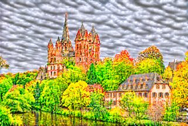<br>d = 0.430 | 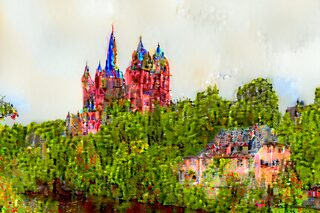<br>d = 0.255 |
| 30 | <br>d = 0.258 | 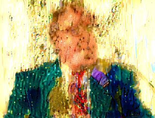<br>d = 0.350 | <br>d = 0.465 | <br>d = 0.315 |
| 40 | <br>d = 0.327 | <br>d = 0.349 | 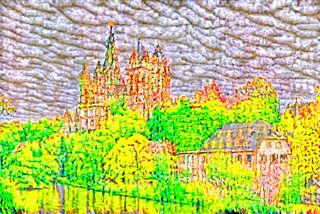<br>d = 0.472 | 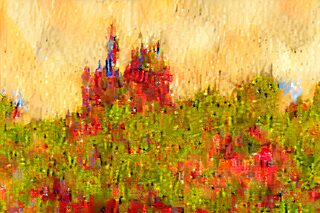<br>d = 0.380 |
| 50 | <br>d = 0.381 | <br>d = 0.354 | 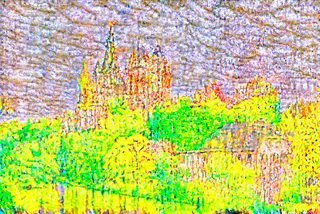<br>d = 0.474 | 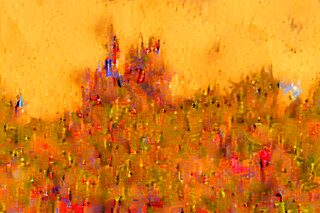<br>d = 0.367 |
| 60 | <br>d = 0.412 | 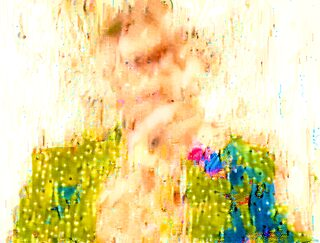<br>d = 0.362 | 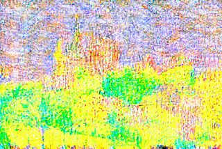<br>d = 0.472 | 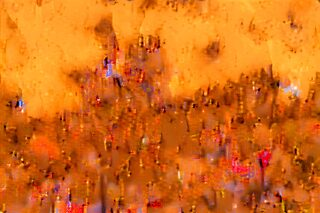<br>d = 0.385 |
| 70 | <br>d = 0.430 | 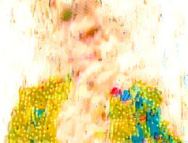<br>d = 0.363 | 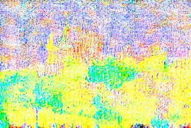<br>d = 0.468 | 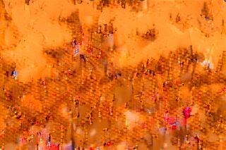<br>d = 0.396 |
| 80 | <br>d = 0.447 | 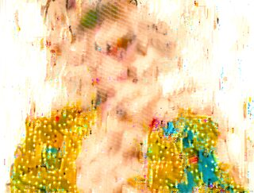<br>d = 0.369 | 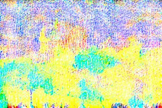<br>d = 0.466 | 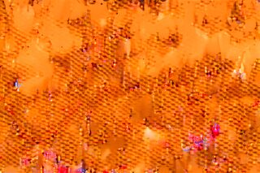<br>d = 0.414 |
| 90 | <br>d = 0.453 | 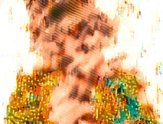<br>d = 0.378 | 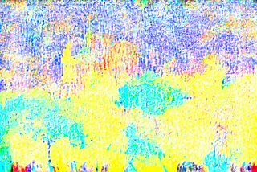<br>d = 0.465 | 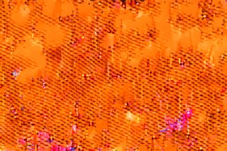<br>d = 0.433 |
| 100 | <br>d = 0.465 | <br>d = 0.376 | 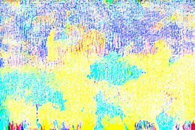<br>d = 0.463 | 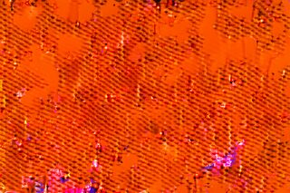<br>d = 0.459 |
<!-- comparison:end -->

## Prompt v2 on Alan Turing

Prompt v2 ([text](recreate-101/references/prompt-v2.txt)) asks the model to match colors, contrast, sharpness and grain, and to not enhance anything. It targets the drift seen with v1. The source is a public-domain photo of Alan Turing at age 16. The ComfyUI v1 run is the control for the prompt effect. The decision rule is in [IMPLEMENTATION.md](IMPLEMENTATION.md): v2 must lower `d` by at least 0.05 at generations 50 and 100. One chain per arm is an indication, not a result.

<!-- turing:start -->
| Run | Provider | Prompt | Generations | Refusals | Median time per generation | Status |
| --- | --- | --- | --- | --- | --- | --- |
| Turing, Codex, v2 | `codex-host-image-tool` | prompt-v2 | 100 / 100 | 9 | 31.4 s (100 timed) | complete |
| Turing, ComfyUI, v2 | `comfyui-flux2-klein-4b-distilled` | prompt-v2 | 100 / 100 | 0 | 15.7 s (100 timed) | complete |
| Turing, ComfyUI, v1 | `comfyui-flux2-klein-4b-distilled` | v1 | 100 / 100 | 0 | 15.7 s (100 timed) | complete |

| Generation | Turing, Codex, v2 | Turing, ComfyUI, v2 | Turing, ComfyUI, v1 |
| --- | --- | --- | --- |
| 0 | <br>d = 0.000 | <br>d = 0.000 | <br>d = 0.000 |
| 10 | <br>d = 0.100 | <br>d = 0.223 | <br>d = 0.184 |
| 20 | <br>d = 0.243 | 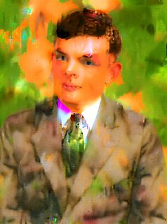<br>d = 0.317 | 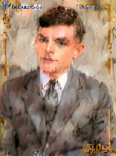<br>d = 0.287 |
| 30 | <br>d = 0.384 | 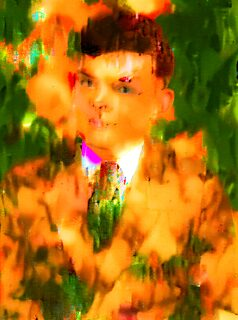<br>d = 0.385 | 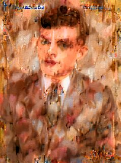<br>d = 0.361 |
| 40 | <br>d = 0.425 | 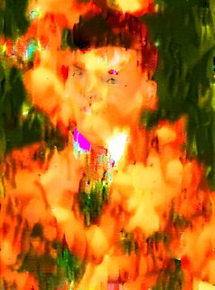<br>d = 0.399 | 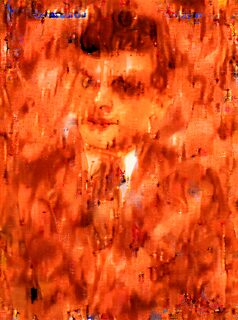<br>d = 0.394 |
| 50 | <br>d = 0.437 | 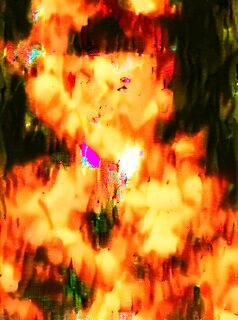<br>d = 0.414 | 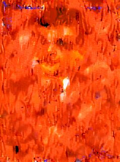<br>d = 0.397 |
| 60 | <br>d = 0.449 | 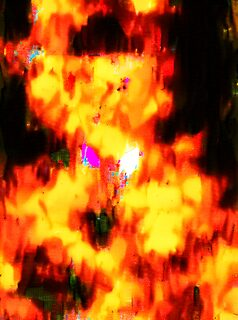<br>d = 0.424 | 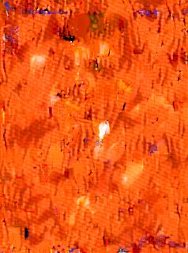<br>d = 0.415 |
| 70 | 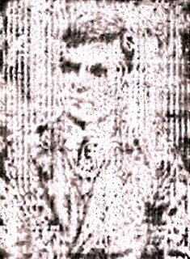<br>d = 0.461 | 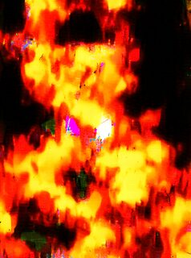<br>d = 0.440 | 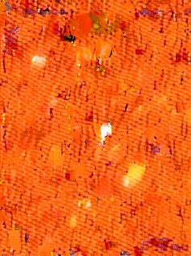<br>d = 0.437 |
| 80 | 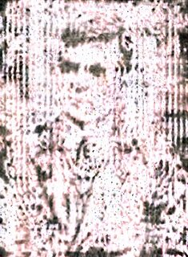<br>d = 0.462 | <br>d = 0.443 | <br>d = 0.456 |
| 90 | <br>d = 0.466 | <br>d = 0.441 | <br>d = 0.464 |
| 100 | <br>d = 0.467 | <br>d = 0.440 | <br>d = 0.473 |
<!-- turing:end -->

## Five popular subjects on ComfyUI

Five more chains run on the local ComfyUI path with prompt v2: a cat, a dog, a Christmas market, a celebrity portrait and a famous painting. Each chain targets 100 generations, with only the previous frame as input. The sources are CC0, CC BY-SA or public domain. See [the source notes](examples/README.md). These runs have no Codex arm. They show how different subjects drift with one model and one prompt.

<!-- linkedin:start -->
| Run | Provider | Prompt | Generations | Refusals | Median time per generation | Status |
| --- | --- | --- | --- | --- | --- | --- |
| Cat | `comfyui-flux2-klein-4b-distilled` | prompt-v2 | 100 / 100 | 0 | 15.4 s (100 timed) | complete |
| Corgi | `comfyui-flux2-klein-4b-distilled` | prompt-v2 | 100 / 100 | 0 | 15.5 s (100 timed) | complete |
| Christmas market | `comfyui-flux2-klein-4b-distilled` | prompt-v2 | 100 / 100 | 0 | 15.4 s (100 timed) | complete |
| Dwayne Johnson | `comfyui-flux2-klein-4b-distilled` | prompt-v2 | 100 / 100 | 0 | 15.4 s (100 timed) | complete |
| Mona Lisa | `comfyui-flux2-klein-4b-distilled` | prompt-v2 | 100 / 100 | 0 | 15.5 s (100 timed) | complete |

| Generation | Cat | Corgi | Christmas market | Dwayne Johnson | Mona Lisa |
| --- | --- | --- | --- | --- | --- |
| 0 | <br>d = 0.000 | <br>d = 0.000 | <br>d = 0.000 | <br>d = 0.000 | <br>d = 0.000 |
| 10 | <br>d = 0.264 | <br>d = 0.309 | <br>d = 0.321 | <br>d = 0.181 | <br>d = 0.325 |
| 20 | <br>d = 0.279 | <br>d = 0.364 | <br>d = 0.372 | <br>d = 0.227 | <br>d = 0.362 |
| 30 | <br>d = 0.304 | <br>d = 0.390 | <br>d = 0.399 | <br>d = 0.296 | <br>d = 0.393 |
| 40 | <br>d = 0.326 | <br>d = 0.396 | <br>d = 0.410 | <br>d = 0.336 | <br>d = 0.406 |
| 50 | <br>d = 0.357 | <br>d = 0.403 | <br>d = 0.421 | <br>d = 0.351 | <br>d = 0.408 |
| 60 | <br>d = 0.374 | <br>d = 0.407 | <br>d = 0.423 | <br>d = 0.369 | <br>d = 0.406 |
| 70 | <br>d = 0.387 | <br>d = 0.420 | <br>d = 0.423 | <br>d = 0.383 | <br>d = 0.403 |
| 80 | <br>d = 0.389 | <br>d = 0.433 | <br>d = 0.434 | <br>d = 0.370 | <br>d = 0.415 |
| 90 | <br>d = 0.381 | <br>d = 0.441 | <br>d = 0.442 | <br>d = 0.362 | <br>d = 0.413 |
| 100 | <br>d = 0.383 | <br>d = 0.448 | <br>d = 0.441 | <br>d = 0.360 | <br>d = 0.420 |
<!-- linkedin:end -->

## Prompt v3: steered drift toward a painting

Prompt v3 asks for an almost exact copy plus one very small step toward a post-impressionist oil painting. Over 100 generations the small steps should add up to a painted style. The five subjects above run again with v3, with the same model, seed and source. Compare each row with the v2 table above. The decision rule is in [IMPLEMENTATION.md](IMPLEMENTATION.md).

<!-- steered:start -->
| Run | Provider | Prompt | Generations | Refusals | Median time per generation | Status |
| --- | --- | --- | --- | --- | --- | --- |
| Cat, v3 | `comfyui-flux2-klein-4b-distilled` | prompt-v3 | 100 / 100 | 0 | 15.8 s (100 timed) | complete |
| Corgi, v3 | `comfyui-flux2-klein-4b-distilled` | prompt-v3 | 100 / 100 | 0 | 15.5 s (100 timed) | complete |
| Christmas market, v3 | `comfyui-flux2-klein-4b-distilled` | prompt-v3 | 100 / 100 | 0 | 15.4 s (100 timed) | complete |
| Dwayne Johnson, v3 | `comfyui-flux2-klein-4b-distilled` | prompt-v3 | 100 / 100 | 0 | 15.4 s (100 timed) | complete |
| Mona Lisa, v3 | `comfyui-flux2-klein-4b-distilled` | prompt-v3 | 100 / 100 | 0 | 15.5 s (100 timed) | complete |

| Generation | Cat, v3 | Corgi, v3 | Christmas market, v3 | Dwayne Johnson, v3 | Mona Lisa, v3 |
| --- | --- | --- | --- | --- | --- |
| 0 | <br>d = 0.000 | <br>d = 0.000 | <br>d = 0.000 | <br>d = 0.000 | <br>d = 0.000 |
| 10 | <br>d = 0.373 | <br>d = 0.337 | <br>d = 0.347 | <br>d = 0.375 | <br>d = 0.340 |
| 20 | <br>d = 0.397 | <br>d = 0.352 | <br>d = 0.395 | <br>d = 0.392 | <br>d = 0.373 |
| 30 | <br>d = 0.425 | <br>d = 0.390 | <br>d = 0.432 | <br>d = 0.412 | <br>d = 0.411 |
| 40 | <br>d = 0.442 | <br>d = 0.410 | <br>d = 0.451 | <br>d = 0.426 | <br>d = 0.440 |
| 50 | <br>d = 0.461 | <br>d = 0.423 | <br>d = 0.463 | <br>d = 0.429 | <br>d = 0.452 |
| 60 | <br>d = 0.467 | <br>d = 0.433 | <br>d = 0.472 | <br>d = 0.440 | <br>d = 0.459 |
| 70 | <br>d = 0.472 | <br>d = 0.442 | <br>d = 0.476 | <br>d = 0.454 | <br>d = 0.467 |
| 80 | <br>d = 0.474 | <br>d = 0.445 | <br>d = 0.474 | <br>d = 0.461 | <br>d = 0.470 |
| 90 | <br>d = 0.471 | <br>d = 0.442 | <br>d = 0.472 | <br>d = 0.463 | <br>d = 0.472 |
| 100 | <br>d = 0.469 | <br>d = 0.445 | <br>d = 0.474 | <br>d = 0.468 | <br>d = 0.471 |
<!-- steered:end -->

## Prompt v3 with img2img: really small steps

The first v3 runs jump to a full painting in generation 1. The cause is the graph: it paints every frame from pure noise, so the model redraws the whole image. The img2img graph ([comfy-flux2-klein-img2img.json](recreate-101/references/comfy-flux2-klein-img2img.json)) starts from the previous frame and removes only a little noise (denoise 0.25). One generation then changes the image by a very small amount (`d` about 0.01). The question is whether 100 small steps add up to a painted style. The cat with prompt v2 on the same graph is the control: it shows how much of the drift comes from the loop and not from the prompt. The decision rule is in [IMPLEMENTATION.md](IMPLEMENTATION.md).

<!-- img2img:start -->
| Run | Provider | Prompt | Generations | Refusals | Median time per generation | Status |
| --- | --- | --- | --- | --- | --- | --- |
| Cat, v3 img2img | `comfyui-flux2-klein-4b-img2img-d0.25` | prompt-v3 | 100 / 100 | 0 | 8.5 s (100 timed) | complete |
| Corgi, v3 img2img | `comfyui-flux2-klein-4b-img2img-d0.25` | prompt-v3 | 0 / 100 | 0 | Unavailable | running or stopped |
| Christmas market, v3 img2img | `comfyui-flux2-klein-4b-img2img-d0.25` | prompt-v3 | 0 / 100 | 0 | Unavailable | running or stopped |
| Dwayne Johnson, v3 img2img | `comfyui-flux2-klein-4b-img2img-d0.25` | prompt-v3 | 0 / 100 | 0 | Unavailable | running or stopped |
| Mona Lisa, v3 img2img | `comfyui-flux2-klein-4b-img2img-d0.25` | prompt-v3 | 0 / 100 | 0 | Unavailable | running or stopped |
| Cat, v2 img2img (control) | `comfyui-flux2-klein-4b-img2img-d0.25` | prompt-v2 | 74 / 100 | 0 | 8.6 s (74 timed) | running or stopped |

| Generation | Cat, v3 img2img | Corgi, v3 img2img | Christmas market, v3 img2img | Dwayne Johnson, v3 img2img | Mona Lisa, v3 img2img | Cat, v2 img2img (control) |
| --- | --- | --- | --- | --- | --- | --- |
| 0 | <br>d = 0.000 | <br>d = 0.000 | <br>d = 0.000 | <br>d = 0.000 | <br>d = 0.000 | <br>d = 0.000 |
| 10 | <br>d = 0.168 | — | — | — | — | <br>d = 0.143 |
| 20 | <br>d = 0.340 | — | — | — | — | <br>d = 0.303 |
| 30 | <br>d = 0.378 | — | — | — | — | <br>d = 0.369 |
| 40 | <br>d = 0.396 | — | — | — | — | <br>d = 0.394 |
| 50 | <br>d = 0.404 | — | — | — | — | <br>d = 0.409 |
| 60 | <br>d = 0.406 | — | — | — | — | <br>d = 0.416 |
| 70 | <br>d = 0.409 | — | — | — | — | <br>d = 0.420 |
| 80 | <br>d = 0.412 | — | — | — | — | — |
| 90 | <br>d = 0.416 | — | — | — | — | — |
| 100 | <br>d = 0.417 | — | — | — | — | — |
<!-- img2img:end -->

## Niklaus Wirth experiment


The current animation uses the Codex image tool. The experiment targets 101 generations. The original photograph is by Tyomitch. See [the source and license notes](examples/README.md). The source and generated PNGs are in [the pilot directory](pilot-niklaus-wirth/). The GIF is a color-quantized viewing copy.

## ComfyUI local path


A second, fully local chain uses ComfyUI on the workstation GPU (RTX A2000, 8 GB). The model is FLUX.2 [klein] 4B distilled (Apache 2.0), with the same fixed prompt and only the previous frame as input. A generation takes about 15 s. The colours and the contrast grow with each generation. See [COMFYUI_PATH.md](COMFYUI_PATH.md) and [the run directory](pilot-comfyui-niklaus-wirth/). The driver is `recreate-101/scripts/comfy-chain.mjs`.

## Limburg Cathedral experiment

The second chain uses a CC BY-SA 3.0 photo of Limburg Cathedral by Norbert Nagel. It targets 100 generations with the same driver. See [its page](pilot-limburg-cathedral/README.md).

## Checkpoints and usage

The checkpoint table for this run is on [its own page](pilot-niklaus-wirth/README.md).

Generations 1–12 ran in one Codex session on 2026-11-09. The image tool refused generation 13 at the output moderation stage. From 2026-11-10, Claude Code runs the chain. It starts one fresh `codex exec` session for each generation with `recreate-101/scripts/codex-chain.sh`. The prompt does not change. A refused frame is sent again, at most three times in a row. See the [experiment report](pilot-niklaus-wirth/report.md).

The host tool does not expose image token counts, per-call charges, or remaining subscription allowance. "Codex agent tokens" are the tokens of the `codex exec` sessions that called the tool. These values are unknown, not zero. A generation may consume included usage. The count is the number of completed image-tool calls in this experiment.

## Setup

Install Node.js 24, ImageMagick (`convert` and `identify`), FFmpeg (`ffprobe`), and ShellCheck. Copy `recreate-101/` to the supported skill directory for your agent. The skill uses Codex's built-in image tool when the host provides it. The agent must invoke that tool once for each frame. The Node scripts cannot invoke the private tool by themselves.

In Codex, request: `Use recreate-101 on /path/to/image.jpg for 10 generations.` The agent reads [SKILL.md](recreate-101/SKILL.md) and follows [the operating reference](recreate-101/references/usage.md). The host tool may consume included usage. Its token count and cost are not exposed by this runner.

## Local test

Run the no-network mock test with a local input:

```sh
node recreate-101/scripts/recreate.mjs run --input examples/niklaus-wirth.jpg --iterations 3 --provider mock --budget-usd 0
```

The mock changes a pixel in each frame. It does not call an image model. For a real Codex tool run, use the agent and the host checkpoint commands in the operating reference. The optional direct API path requires separate credentials, an explicit budget, and acceptance of its estimated reserve.

## Checks

```sh
./localPipeline.sh
```

The pipeline checks shell syntax with ShellCheck, checks JavaScript syntax, runs the Node tests, and enforces 95% line coverage. The tests cover mock and host checkpoint workflows. They do not measure real image quality or API billing. The [GitHub Actions workflow](../.github/workflows/recreate-101.yml) runs the same pipeline. This project has no graphical UI or Docker image.

## Scripts

- `recreate-101/scripts/host.mjs` records a host-tool run, its refusals and checkpoints, and builds its GIF.
- `recreate-101/scripts/codex-chain.sh` runs a host-tool chain with one `codex exec` session per generation.
- `recreate-101/scripts/comfy-chain.mjs` runs a chain through a local ComfyUI server, one API prompt per generation.
- `recreate-101/scripts/recreate.mjs` runs the mock or optional direct API provider.
- `localPipeline.sh` runs local checks.

The [vision](vision.md) defines the experiment. [IMPLEMENTATION.md](IMPLEMENTATION.md) records progress and restart commands. [review_20261109.md](review_20261109.md) records known limits.

## License

The project code is GPL-3.0-or-later. See [LICENSE](LICENSE). The images have their own terms, recorded in [examples/README.md](examples/README.md):

- Niklaus Wirth (Tyomitch): copyrighted free use; personality rights can apply.
- Limburg Cathedral (Norbert Nagel / Wikimedia Commons): CC BY-SA 3.0. The generated frames, GIFs and comparison thumbnails of both Limburg runs are adaptations under CC BY-SA 3.0.
- Alan Turing at age 16: public domain.
- Tabby cat and Corgi puppy (Pixabay authors via Commons): CC0 1.0.
- Berlin Christmas market (Arild Vågen / Wikimedia Commons): CC BY-SA 3.0. Its generated frames are adaptations under CC BY-SA 3.0.
- Dwayne Johnson (Harald Krichel / Wikimedia Commons): CC BY-SA 4.0. Its generated frames are adaptations under CC BY-SA 4.0. Personality rights apply: no endorsement or advertising use.
- Mona Lisa (Leonardo da Vinci): public domain.
