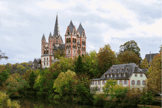

# Limburg Cathedral chain

Target: 100 generations with the Codex image tool. Each generation uses only the previous frame. Photo: Norbert Nagel / Wikimedia Commons, CC BY-SA 3.0. The frames use the same license. See [the source notes](../examples/README.md) and the [report](report.md).

The table is generated from `manifest.json` by `host.mjs readme`. Do not edit it by hand.

<!-- checkpoints:start -->
| Completed generations | Animation | Refusals so far | Codex agent tokens (calls with data) | Subscriber allowance |
| --- | --- | --- | --- | --- |
| 10 | [Checkpoint GIF](checkpoints/0010.gif) | 0 | 581502 in (466816 cached), 1552 out, 10 calls | Unavailable |
| 20 | [Checkpoint GIF](checkpoints/0020.gif) | 0 | 1100075 in (866688 cached), 3117 out, 20 calls | Unavailable |
| 30 | [Checkpoint GIF](checkpoints/0030.gif) | 0 | 1622538 in (1299200 cached), 4725 out, 30 calls | Unavailable |
<!-- checkpoints:end -->
