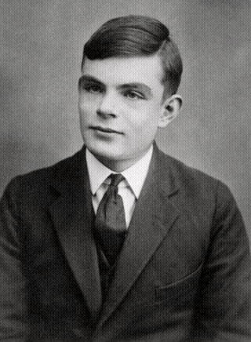

# Alan Turing chain, Codex, prompt v2

Target: 100 generations with the Codex image tool and prompt v2. Source: public domain, see [the source notes](../examples/README.md). See the [report](report.md).

The table is generated from `manifest.json` by `host.mjs readme`. Do not edit it by hand.

<!-- checkpoints:start -->
| Completed generations | Animation | Refusals so far | Codex agent tokens (calls with data) | Subscriber allowance |
| --- | --- | --- | --- | --- |
| 10 | [Frame](frames/0010.avif) | 0 | 435316 in (343552 cached), 2642 out, 10 calls | Unavailable |
| 20 | [Frame](frames/0020.avif) | 0 | 874843 in (708480 cached), 5097 out, 20 calls | Unavailable |
| 30 | [Frame](frames/0030.avif) | 0 | 1311294 in (1061120 cached), 7776 out, 30 calls | Unavailable |
| 40 | [Frame](frames/0040.avif) | 0 | 1750963 in (1422848 cached), 10355 out, 40 calls | Unavailable |
| 50 | [Frame](frames/0050.avif) | 1 | 2189384 in (1773568 cached), 12835 out, 50 calls | Unavailable |
| 60 | [Frame](frames/0060.avif) | 5 | 2629077 in (2111360 cached), 15448 out, 60 calls | Unavailable |
| 70 | [Frame](frames/0070.avif) | 8 | 3065428 in (2454912 cached), 17997 out, 70 calls | Unavailable |
| 80 | [Frame](frames/0080.avif) | 9 | 3502738 in (2808192 cached), 20422 out, 80 calls | Unavailable |
| 90 | [Frame](frames/0090.avif) | 9 | 3940328 in (3155200 cached), 23122 out, 90 calls | Unavailable |
| 100 | [Frame](frames/0100.avif) · [GIF](evolution.gif) | 9 | 4379881 in (3515264 cached), 25635 out, 100 calls | Unavailable |
<!-- checkpoints:end -->
