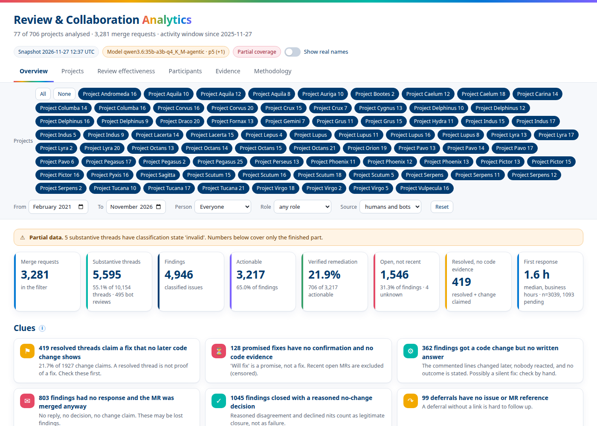

# mrreview: GitLab review and collaboration analytics

[](https://github.com/marcelpetrick/codingWithGPT/actions/workflows/mr-review-analytics.yml)


[](../LICENSE)

mrreview reads the merge request history of a GitLab instance and shows how code review gets work done.
It finds review threads, classifies each finding with a local LLM (Ollama), checks the claimed outcome
against the code, and writes one offline HTML dashboard with clues, drill-downs and a tooltip on every element.
The "Receiving review" table shows each person's reaction profile (fix rate, reply depth, thanks, tone). The project filter has All/None buttons. Activity charts switch between a linear and a logarithmic axis.



Real data, default view: people and projects are pseudonyms. A [synthetic example](docs/img/overview.png) shows the same dashboard on demo data.

## What it answers

- Which projects have the most merge request activity and real review interaction, and how does it change?
- How often do reviews raise actionable findings, and what happens to them?
- How fast do people respond, decide and implement (business hours and wall clock)?
- Which findings are implemented, solved differently, rebutted with a reason, deferred, or left open?
- Where does a "resolved" thread have no code change behind it?
- How does each developer react to review input: do they answer, fix, explain in depth, thank, or reject without a reason?

It keeps acknowledgement, decision, implementation, GitLab resolution, merge and verified remediation apart.
A promise is not a fix. A resolved thread is not proof. A reasoned "no" is a legitimate outcome.

## Status

| Item | State |
|---|---|
| Pipeline (collect, normalize, analyze, evaluate, report) | done, tested |
| Live LLM on synthetic threads (the Ollama box, qwen3.6 35B-A3B) | done: synthetic fixture truth 90.3% (p1), 98.9% (p2). Prompt in use: **p5** (D-024). Real data against Opus labels: outcome 50.0%, response 45.0% (fresh sample, [docs/annotation_result.md](docs/annotation_result.md)) |
| Independent reviews | 27 + 9 + 18 findings fixed: [review](docs/review_20261126.md), [reviewBranch](docs/review_20261126_branch.md), document review (WORKLOG); [review 2026-11-27](docs/review_20261127.md): three rounds (code, dashboard, documents) |
| Live run on real GitLab data | done 2026-11-26: all 77 active projects (of 706 visible), 3,281 MRs, 5,590 valid classified threads (prompt p5, 2026-11-27); data kept local |

The living work log is [WORKLOG.md](WORKLOG.md). Requirements: [docs/requirements.md](docs/requirements.md).
Decisions: [docs/decisions.md](docs/decisions.md). Comparison with published studies: [docs/literature_comparison.md](docs/literature_comparison.md). Architecture (C4): [docs/architecture.md](docs/architecture.md).

## Quick start (synthetic data, no credentials)

1. Install [uv](https://docs.astral.sh/uv/) and Python 3.14.
2. Run the demo with the keyword stub (no LLM, about 5 seconds):

   ```bash
   uv run mrreview demo --out out/demo
   xdg-open out/demo/dashboard.html
   ```

3. Optional: run the demo with the real Ollama box (about 15 minutes for 305 threads):

   ```bash
   MRREVIEW_OLLAMA_URL=http://192.168.100.67:11434 uv run mrreview demo --live --out out/demo-live
   ```

The committed example [docs/demo/dashboard.html](docs/demo/dashboard.html) comes from the same data, built with
`scripts/live_synthetic.py` and `mrreview report --demo` (see WORKLOG.md, "Resume here"). Download it and open it in a browser.

## Use with a real GitLab

Do these steps only after the authorization in VISION.md section 8 is confirmed.

1. Create a token with the `read_api` scope. Put it in the environment, never in a file:

   ```bash
   export MRREVIEW_GITLAB_URL=https://gitlab.example.com
   export MRREVIEW_GITLAB_TOKEN=<read_api token>
   export MRREVIEW_OLLAMA_URL=http://192.168.100.67:11434
   export MRREVIEW_OLLAMA_MODEL=qwen3.6:35b-a3b-q4_K_M-agentic
   ```

2. Start with a bounded smoke test (2 projects, 5 MRs each, 20 threads). Add `--focus-user <username>`
   to rank projects by that person's MRs as author or reviewer, and `--focus-only` to analyse only those:

   ```bash
   uv run mrreview smoke --authorized --focus-user <username> --focus-only --out out/smoke
   ```

3. Read `out/smoke/smoke_dashboard.html` and check some threads against GitLab.
4. Run the full pipeline. Every stage resumes after an interruption:

   ```bash
   uv run mrreview run --out out/dashboard.html
   uv run mrreview status
   ```

5. Check the classification quality with the rubric in [docs/annotation_rubric.md](docs/annotation_rubric.md):
   `mrreview sample`, then `mrreview agreement`.

6. Optional checks and summary: `uv run python scripts/placebo_check.py out/real/mrreview.sqlite3` tests the direct-evidence rule against chance. `uv run python scripts/final_report.py out/real/mrreview.sqlite3 docs/final_report_inputs.json out/real/final_report.html` writes an aggregate-only report.

Each stage also runs alone: `collect` (includes normalize), `evidence`, `analyze`, `evaluate`, `report`.
Settings: [docs/configuration.md](docs/configuration.md). Operations, exit codes, scope widening and data handling:
[docs/operations.md](docs/operations.md).

## How it decides

| Step | Method |
|---|---|
| Substantive thread | Deterministic: a human note adds more than LGTM, thanks or emoji. Bots, system notes and author self-notes are kept apart. |
| Finding, intent, response, tone, stated outcome | LLM with a fixed codebook and a JSON schema. The model can abstain. Names are replaced by role labels before the text leaves. |
| Code evidence | The GitLab compare API from the commit the comment was written on (`head_sha`) to the final MR version: a change within 2 lines of the comment is direct, a change elsewhere in the file indirect. Stored MR version diffs are the fallback. |
| Times | From the first comment to first response, decision, implementation and resolution. Business hours: Mon–Fri 08–18 Europe/Berlin. Pending is never zero. |
| Censoring | An open finding on an open MR with activity in the last 14 days is "recent", not "open". |

## Development

```bash
./localPipeline.sh   # the full gate, mutation testing included; CI runs exactly this
```

Prerequisites: uv, Python 3.14, Node.js (syntax check of the dashboard script only). Playwright downloads Chromium once.

The gate runs Ruff, Black, mypy `--strict`, a syntax check of the dashboard script, and pytest
(unit, integration over real HTTP to fake GitLab and Ollama servers, and end-to-end in Chromium)
with at least 99% line coverage.

## Limits and responsible use

- The LLM can be wrong. Check the evidence before you act on a finding.
- Changed lines are evidence of a change, not proof of a correct fix.
- Person-level tables are context. They are not a score, a ranking or a judgement of personality.
- The name toggle is a display switch, not anonymisation: the normal HTML file holds real names, so keep it confidential.
  To pass a file on, build it with `uv run mrreview report --share --out out/share.html`: that file holds only pseudonyms and no links, paths or e-mail addresses.
- No GitLab write calls exist in the code. No review text goes to an external service.

## License

GPL-3.0-or-later. See [LICENSE](../LICENSE).
