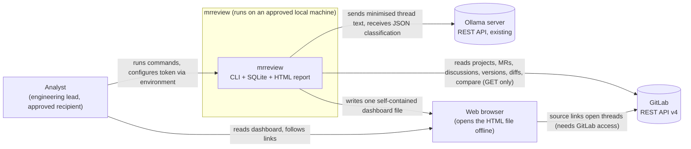
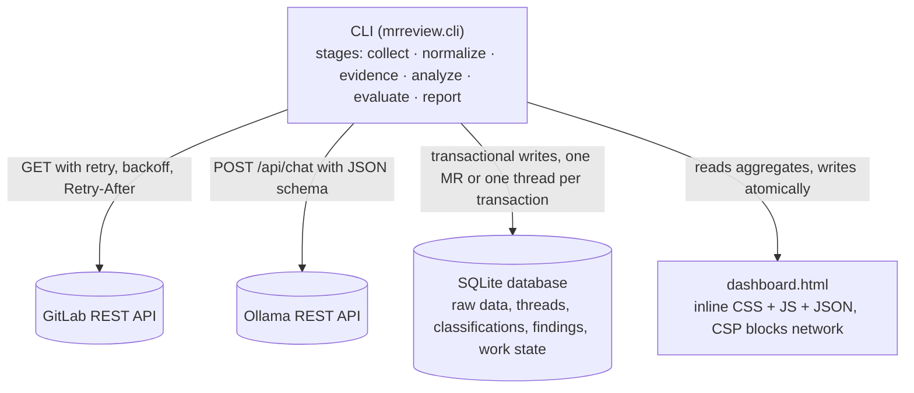
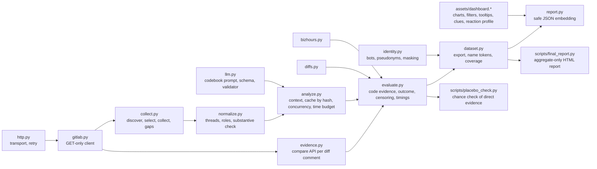

# Architecture (C4)

Every diagram below is editable Mermaid. GitHub renders it. Check the rendering after each change.

## Level 1: system context

Purpose: show who uses mrreview and which external systems it touches. Scope: the whole system.

## Level 2: containers

Purpose: show the parts of mrreview and the data each part owns. Scope: inside the system boundary.

## Level 3: components of the pipeline

Purpose: answer "which module owns which decision". Scope: the Python package `src/mrreview`.

## Decisions that shape the design

| Topic | Decision | Requirement |
|---|---|---|
| Unit of analysis | The review thread. The LLM splits it into findings. | REQ-UNIT-1 |
| Determinism | Counting, timing, roles and code evidence are plain Python. The LLM only classifies text. | REQ-LLM-1 |
| Evidence | The GitLab compare API from the comment's head_sha to the final version decides direct or indirect; stored version diffs are the fallback (GitLab drops old version diffs). | REQ-OUT-1 |
| Portability | Numbered migrations with pinned checksums, a backup before each migration, and a JSON-lines export that imports into the current layout. | REQ-DB-1 |
| Resumption | A work table per MR and per thread; content hashes decide what is stale. | REQ-DB-2 |
| Privacy | Names never reach the LLM (role labels). The HTML holds name tokens; the toggle swaps them. People, bots and projects get pseudonyms. | REQ-UI-5, REQ-UI-6 |
| Safety | Model output is validated data. Nothing in it is executed. The client has no write method. | REQ-LLM-2, REQ-SEC-1 |
