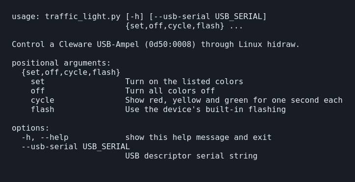

# Cleware USB traffic light

[](docs/requirements.md)
[](LICENSE)
[](docs/requirements.md)

Control a Cleware USB-Ampel on Linux from Python. The light has red, yellow and green channels.

## Hardware and firmware

| Item | Finding |
| --- | --- |
| USB identity | Cleware GmbH USB-Ampel, vendor `0d50`, product `0008`. |
| USB release | `bcdDevice = 0x0080`, shown as `0.80` by `lsusb`. |
| USB interface | Low speed at 1.5 Mbit/s. HID 1.11, interface 0. Linux uses `usbhid` and `hid-generic`. |
| Endpoints | Interrupt IN `0x81` and OUT `0x02`. Each advertises an 8-byte maximum packet and a 10 ms interval. |
| Reports | Vendor-defined, with 6 input bytes and 3 output bytes. Reports have no report ID. |
| Power | The attached unit reports bus power and a 100 mA maximum in its descriptor. Cleware lists up to 440 mA for the product. Actual current was not measured. |
| Controller | Likely Cypress CY7C63813 enCoRe II. It has an M8C core, 8 KiB of flash and 256 bytes of RAM. The chip marking and package remain unverified. |

The USB descriptor presents `63813` as the serial string. Cleware's Linux source treats it as a controller marker.
The source assigns hardware revision 13 and reads the unit's actual serial from device memory.
The controller part is an inference from that marker and the Cypress part number.
The available sources give host software and a controller data sheet. The device firmware image and PCB schematic remain unknown.
[Cleware Linux sources](https://www.cleware.info/downloads/Linux_Ubuntu.zip) ·
[Infineon controller data sheet](https://www.infineon.com/assets/row/public/documents/30/49/infineon-cy7c63310-cy7c638xx-encore-ii-low-speed-usb-peripheral-controller-datasheet-en.pdf)

The standard shop model is article 37-1. Cleware lists a 40 × 90 × 23 mm IP30 indoor housing and a range of −20 to +80 °C.
Cleware describes seven LEDs of about 200 mcd each in each color area.
The shop offers cable length and splash protection options. The USB descriptors do not identify the fitted options.
[Shop product page](https://www.cleware-shop.de/USB-Ampel-EN) ·
[Cleware hardware description](https://www.cleware.info/data/usbampel_E.html)

## What the light can do

| Function | Evidence |
| --- | --- |
| Show red, yellow or green | Cleware documents three independent channels. |
| Show two colors together | Cleware shows red and yellow together in the device manual. The Python command sends one report per channel. |
| Switch all channels off | Cleware provides a command to clear all channels. |
| Flash a channel | Cleware documents state values 16, 17 and 18 for 0.5, 1 and 2 second flash intervals. |
| Report switch state | Cleware's API defines `GetSwitch`. This reports the logical switch state. |
| Run as USB-WatchLight | Cleware documents a heartbeat mode for supported firmware. It shows one color at a time and starts at red. |

[Device manual](https://www.cleware.info/downloads/english/devices.pdf) ·
[Cleware API](https://www.cleware.info/data/API_E.pdf) ·
[Cleware command FAQ](https://www.cleware-shop.de/FAQs/en)

The attached light reported red, yellow, green, off, and red plus yellow during live tests.
The flash command set yellow. The HID reports did not show the physical flash timing.

## USB control

Write `00 channel state` as three bytes to interrupt endpoint `0x02`.
Use channel `0x10` for red, `0x11` for yellow and `0x12` for green.
Use state `0` for off and `1` for steady on.
Add a zero report ID byte at the start when you use Linux hidraw.
For example, send `00 00 10 01` to hidraw to turn red on.
[Cleware Linux sources](https://www.cleware.info/downloads/Linux_Ubuntu.zip) ·
[Linux hidraw documentation](https://docs.kernel.org/7.0/hid/hidraw.html)

## Cleware software

| Tool | Use |
| --- | --- |
| ClewareControl | Windows interface for timers, sensor actions, device configuration and remote display. |
| USBampel / USBtrafficLight | Small Windows interface for manual control. |
| USBswitchCMD | Command-line control. The Linux package provides `USBswitchCmd` with source and example programs. |
| USBaccess | Windows DLL and Linux C and C++ source for integration. Cleware also provides LabVIEW samples. |

[Cleware downloads](https://www.cleware-shop.de/Software-E) ·
[Cleware Linux downloads](https://www.cleware-shop.de/Software-E/Linux)

The official Linux CLI built on Manjaro. It prints usage with `./USBswitchCmd -h`.
Its source uses the older `/dev/usb/hiddev*` interface.
Use `./USBswitchCmd -l` to list the available devices once you have access to that interface.
With one accessible light, use `./USBswitchCmd r y` for red and yellow or `./USBswitchCmd o` for all off.

## Setup and use

Linux with Python 3.14 is the supported target. The program uses only the standard library.
Run the commands from this directory.



1. Check that Linux sees the light.

   ```sh
   lsusb -d 0d50:0008
   ```

2. Install the udev rule once.

   ```sh
   sudo install -m 0644 udev/70-cleware-ampel.rules /etc/udev/rules.d/70-cleware-ampel.rules
   sudo udevadm control --reload-rules
   ```

   Unplug the light and plug it in again. The active local login gets access after each replug or reboot.
   Check for an entry with your account and `rw-` in the output of `getfacl`.

   ```sh
   getfacl /dev/input/by-id/usb-Cleware_GmbH_USB-Ampel_63813-hidraw
   ```

3. Cycle through all three colors. Each stays on for one second. The cycle ends with all lights off.

   ```sh
   python3 traffic_light.py cycle
   ```

4. Set a color or a combination.

   ```sh
   python3 traffic_light.py set green
   python3 traffic_light.py set red yellow
   python3 traffic_light.py set red yellow green
   python3 traffic_light.py flash 0.5 yellow
   python3 traffic_light.py off
   ```

Use `set` to replace the full light state. It switches off any color you do not name.
Use `flash` with an interval of `0.5`, `1` or `2` seconds.
The program sends changes in separate reports, one per channel.
The channel changes can therefore take effect at slightly different times.
If you connect more than one matching light, use `--usb-serial` to select a device by its USB descriptor string.
If two units expose the same marker, their descriptor strings alone cannot tell them apart.

### Temporary access

Use this command if you need access for one USB connection.

```sh
sudo setfacl -m "u:$(id -un):rw" /dev/input/by-id/usb-Cleware_GmbH_USB-Ampel_63813-hidraw
```

### Small Python example

```python
from traffic_light import find_device, set_lights

with find_device("63813").open("wb", buffering=0) as device:
    set_lights(device, ("red", "yellow"))
```

Each CLI invocation locks the device while it sends reports. Use the CLI for concurrent callers.

## Monitor Claude and Codex agents

Run the optional Python monitor to show the combined state of Claude, Claude DMO, Codex and Codex DMO.
See [agent status](docs/agent-status.md) for installation, color priority and coverage.

## Build and test

Run these commands from a clean source checkout with Python 3.14.10 and Git.

```sh
python3 -m venv .venv
. .venv/bin/activate
python -m pip install --only-binary=:all: -r requirements-dev.txt
ruff check traffic_light.py agent_status.py tests tools
black --check traffic_light.py agent_status.py tests tools
pymarkdown --config .pymarkdown.json scan README.md docs
yamllint --strict .github/workflows
udevadm verify udev/70-cleware-ampel.rules
coverage erase
coverage run --append -m unittest discover -s tests
coverage run --append traffic_light.py --help
coverage run --append agent_status.py --help
coverage json -o - | python tools/check_coverage.py
python tools/mutation_check.py
python tools/build_release.py v0.0.0
(cd dist && sha256sum --check SHA256SUMS)
```

The tests check reports without a USB device. The release build runs the packaged command and checks the missing-device error.
The build writes a Linux source archive, SHA-256 checksums, an SPDX SBOM and a changelog in `dist/`.
The local build uses `v0.0.0` as a test version. Publishing uses a checked Git tag through the release job.
The project workflow also runs actionlint on its YAML and embedded shell commands.
GitHub runs it when this directory is a repository root. The parent repository does not discover a workflow below its root.
See the [architecture](docs/architecture.md) and [work record](docs/requirements.md).

## License

The project uses GNU GPL v3 or later. See [LICENSE](LICENSE).
