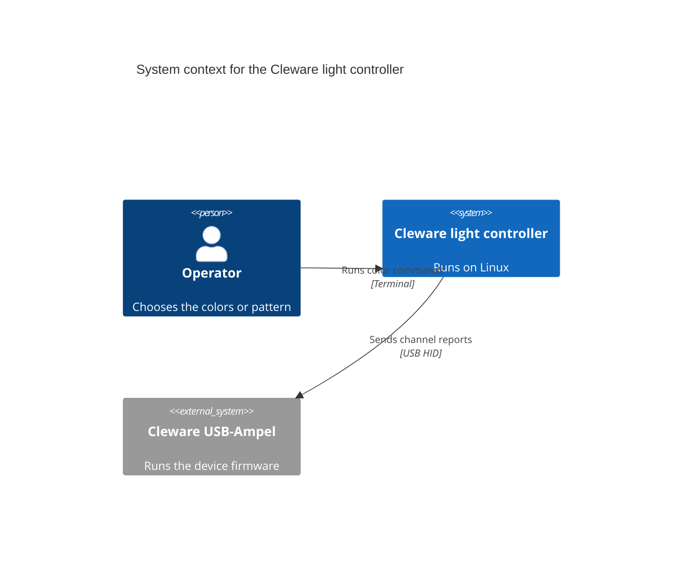
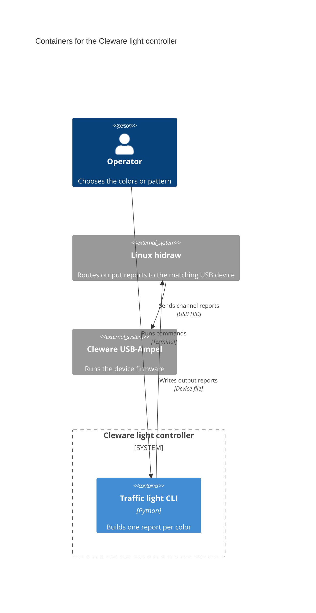

# Architecture

## C4 level 1 system context

This view shows who sets the light and what is outside the Linux controller.

## C4 level 2 container view

This view shows how the Python process reaches the light.
The controller has one process and no data store.

