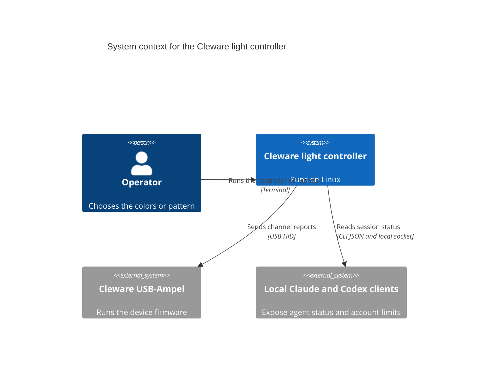
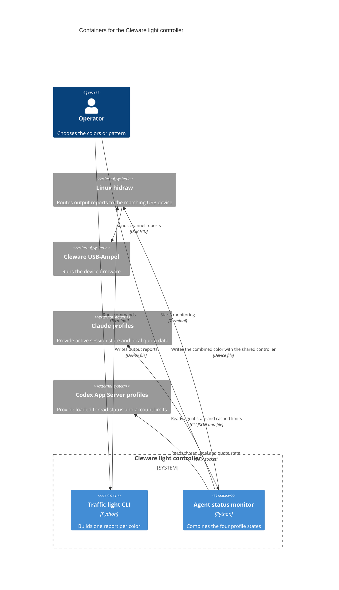

# Architecture

## C4 level 1 system context

This view shows who sets the light and what is outside the Linux controller.

## C4 level 2 container view

This view shows how the manual controller and the status monitor reach the light.
They share Python code and keep no project data store.

