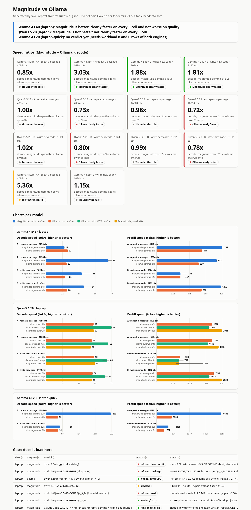

# Magnitude versus Ollama

[](https://github.com/marcelpetrick/codingWithGPT/actions/workflows/magnitude-versus-ollama.yml)
[](LICENSE)
[](https://www.python.org/)
[](pyproject.toml)
[](https://github.com/magnitudedev/magnitude)
[](https://ollama.com)

**Is [Magnitude](https://github.com/magnitudedev/magnitude) really faster than Ollama for the same model on
the same GPU, without lower answer quality?** The vendor claims "over 2x faster". This project measures it
on an RTX A2000 8 GB laptop with a fixed decision rule.

**Author: Marcel Petrick <mail@marcelpetrick.it>**

**License: GPLv3 or later. See [`LICENSE`](LICENSE).**

**Note: project is generated with AI.**

## Verdict

**Magnitude is faster only where it has a drafter that Ollama does not have.** The engine itself is not
faster at decode. Measured on an RTX A2000 8 GB laptop, 2026-10-29, fixed rule (n = 5, median ≥ 25% higher
and no range overlap):

| Model | Magnitude | Ollama | New code (B) decode | Rule verdict |
|---|---|---|---|---|
| **Gemma 4 E4B** QAT Q4 (fills the 8 GB) | MTP drafter, 48–51 tok/s | no MTP tag, 25–28 tok/s | **1.81–1.88x** | **Magnitude better** |
| Qwen3.5 2B Q4_K_M | no drafter offered, 50–53 tok/s | plain tag, 50–52 tok/s | 0.99–1.02x | tie |
| Qwen3.5 2B Q4_K_M | no drafter offered, 50–53 tok/s | MTP tag, 63–66 tok/s | 0.78–0.80x | **Ollama clearly faster** |
| Gemma 4 E2B QAT Q4 (quick test, n = 3) | MTP drafter, 58 tok/s | no MTP tag, 51 tok/s | 1.15x | tie |

- **Without a drafter, both engines decode at the same speed** (Qwen 2B: 0.98–1.02x; Gemma E4B on the one
  prompt where Magnitude did not draft: 24.6 vs 25–29 tok/s).
- **Prefill** is often faster on Magnitude (1.1–1.4x with long prompts), but mostly within the tie band.
- **The vendor's repeat task inflates the gain**: 3.0x (E4B, 16k) and 5.4x (E2B, 4k), against 1.8x on new code.
- **Magnitude's drafter is prompt-dependent**: on one 3.2k-token prompt it did not draft at all (reproduced).
- **Quality and vision are kept**: C 19/20 vs 17/20 (E4B), 14/20 vs 12/20 (Qwen 2B); V 5/5 vs 5/5 and 4/5 vs 4/5. All ties.
- **Fit is worse on 8 GB**: Magnitude plans for the full 256K context and refuses Qwen3.5 4B, which Ollama
  runs in 3.7 GB. Qwen3 / Qwen3-VL have no Magnitude kernels. Qwen3.6 35B does not fit (no MoE offload).
- **Not a drop-in for the Ollama API** (see below). Claude Code works through `/inference/anthropic` (smoke test: one tool call, 25 s).

See [`report.md`](report.md) (generated) and [`PLAN.md`](PLAN.md) (living document).



## Where it ran

The results hold for this machine and these settings. Other models, other GPUs (more VRAM, other
architectures), other context sizes, other drivers or other engine versions can give other results.
For example, the vendor measured on a DGX Spark and an M4 Pro, with 64k context only.

| Item | Value |
|---|---|
| Machine | Dell Precision 5570 laptop, on AC power, power profile "balanced" |
| CPU / RAM | Intel i9-12900H (20 threads) / 32 GB |
| GPU | NVIDIA RTX A2000 8 GB Laptop GPU, compute capability 8.6, driver 610.57.04, CUDA 13.3 |
| OS | Manjaro Linux, kernel 7.1.13-2 |
| Ollama | 0.40.4, systemd service, `127.0.0.1:11434`, models in `/home/ollama-models`, flash attention off, default KV cache, `OLLAMA_NUM_PARALLEL=1` |
| Magnitude | 0.2.14 (pacman package), server mode, `0.0.0.0:10100`, models in `/home/magnitude-data/models`, kernels tuned on first load |
| Harness | `mvo` (this project), Python 3.14, client-side timing over HTTP on localhost |
| Date | 2026-10-29 |

Models and what decided them (8 GB VRAM):

| Model | Magnitude | Ollama | Role here |
|---|---|---|---|
| Gemma 4 E4B QAT Q4 | catalog, MTP drafter, "Snug (8 GB)" | `gemma4:e4b-it-qat`, no MTP tag | Main match: fills the GPU |
| Gemma 4 E2B QAT Q4 | catalog, MTP drafter | `gemma4:e2b-it-qat`, no MTP tag | Quick test |
| Qwen3.5 2B Q4_K_M | Hugging Face (unsloth), no drafter | `qwen3.5:2b-q4_K_M`, `qwen3.5:2b-mtp-q4_K_M` | Qwen match, pure engine |
| Qwen3.5 4B | refused (plans 256K context) | runs | Gate result only |
| Qwen3 / Qwen3-VL | no kernels for the architecture | runs | Not comparable |
| Qwen3.6 35B-A3B | does not fit (no MoE offload) | CPU offload only | Not comparable here |

## Is Magnitude a drop-in replacement for an Ollama server?

**No.** Measured on 2026-10-29 against Magnitude 0.2.14:

| API | Ollama | Magnitude |
|---|---|---|
| Native Ollama API (`/api/chat`, `/api/generate`, `/api/tags`, `/api/pull`) | yes, port 11434 | **no** (404, or the web app HTML) |
| OpenAI Chat Completions | `/v1/chat/completions` | `/inference/v1/chat/completions`, port 10100 |
| Anthropic Messages | `/v1/messages` | `/inference/anthropic` |
| Model IDs | `gemma4:e4b-it-qat` | `gemma-4-e4b-it-qat:gguf:q4`, `hf:owner/repo/file.gguf` |
| Access from the network | no auth (if bound to the LAN) | Bearer key required; localhost needs none |
| Per-request `num_ctx`, `keep_alive` | yes | no (Magnitude plans the context itself) |

What this means for software that already exists:

1. A client of the OpenAI-compatible endpoint can switch. Change the base URL, the model ID and add the key.
2. A client of the native Ollama API cannot switch. This includes the `ollama` Python and JavaScript
   libraries and tools that call `/api/chat` or `/api/generate`.
3. An agent harness that Magnitude knows (Claude Code, Codex, OpenCode, Pi, Cline, and others) is
   connected with `magnitude connections connect <harness>`.

### Claude Code through Magnitude (like the `claude-ol-kat` alias)

Claude Code speaks the Anthropic API. Magnitude serves it at `/inference/anthropic`, so the alias needs
only these changes (not yet run on the box `.67`):

1. `ANTHROPIC_BASE_URL=http://192.168.100.67:10100/inference/anthropic` (port 10100, path `/inference/anthropic`).
2. `ANTHROPIC_AUTH_TOKEN=<Magnitude network key>` instead of `ollama`.
3. The model ID in Magnitude's form, for example `hf:bartowski/Kwaipilot_KAT-Coder-V2.5-Dev-GGUF/<file>.gguf`.
4. Warm the model with `magnitude models load <id>` or one `/inference/v1/chat/completions` request,
   not with Ollama's `/api/generate` and `keep_alive`.

Open points before it can replace the Ollama alias:

| Point | State |
|---|---|
| Magnitude on the shared box `.67` | Needs the owner's approval (shared server). |
| KAT-Coder-V2.5 kernels | Present: Magnitude lists it as a "Variant of Qwen3.6 35B-A3B". |
| Fit of Q5_K_M in ~35.5 GB | Unknown. Magnitude plans memory for the full 256K context. Check with `magnitude catalog inspect` on the box. |
| Chat template | Risk. The GGUF template rejects Claude Code's mid-conversation system messages (Ollama uses its own renderer for it). Magnitude issue #84 reports broken agent sessions after tool calls with strict templates. |
| Quality | The quality round of `ollamaClaudeCode_v4_tielCoder` (ledger session, held-out, T5) must run again on Magnitude. |

## How it measures

- One engine on the GPU at a time. The other engine is unloaded first, and every row records the VRAM in use.
- Same prompt bytes, greedy sampler, all penalties 0, thinking off, same output length for both engines.
- A nonce in the first line of each request defeats the prefix cache.
- Client-side clock on the streamed answer: time to first token, prefill tok/s, decode tok/s.
- Errors, empty answers, timeouts and answers with thinking tokens are failed rows, never speed.
- "Clearly faster" = median ≥ 25% higher and min–max ranges that do not overlap, n ≥ 5. Else a tie.

| Workload | What | Why |
|---|---|---|
| A | Repeat a Moby-Dick passage (4k, 16k context) | The vendor's workload. Best case for speculative decoding. |
| B | Write new code (5 prompts, 1k and 8k context) | The real use. Decides the speed verdict. |
| C | 20 Python tasks with unit tests | Faster but wrong is not better. |
| V | 5 generated images with known answers | Is the vision capability kept? |

## Setup

1. Install Ollama and Magnitude (`curl -fsSL https://magnitude.dev/install.sh | sh`, needs sudo).
2. Check that both engines store models on a partition with free space (see `PLAN.md`, "Disk").
3. Install this project: `./localPipeline.sh` creates `.venv` with `uv` and runs all checks.

## Usage

1. Define the arms (engine, model, drafter, model family) in `arms.json`.
2. Measure one pair, one engine at a time:
   ```sh
   scripts/run_pair.sh laptop A:4096,B:1024 5 \
     magnitude-gemma-e4b gemma-4-e4b-it-qat:gguf:q4 ollama-gemma-e4b gemma4:e4b-it-qat
   ```
3. Run the whole chain detached: see the usage line in `scripts/run_long.sh`.
4. Write the report: `.venv/bin/mvo report`. It writes `report.md` and `dashboard.html` from `results/*.jsonl`.
5. Record a load result: `.venv/bin/mvo gate --site laptop --engine magnitude --model X --status "refused: ..." --detail "..."`.

`mvo run` resumes: rows that exist are skipped. An unreachable engine or a failed warm-up stops the run
with exit code 2 and is never booked as a result.

## Scripts

| Script | Purpose |
|---|---|
| `localPipeline.sh` | Quality gate: ruff, ruff format, mypy --strict, pytest (unit, integration, e2e on a fake engine) with ≥ 95% branch coverage, CLI smoke. CI runs exactly this. |
| `scripts/run_pair.sh` | Measure one Magnitude arm and one Ollama arm, one engine on the GPU at a time, then regenerate the report. |
| `scripts/run_long.sh` | The full laptop run as one sequential, resumable chain (with a disk check before downloads). |
| `scripts/bump_version.sh` | Raise the semver in `src/mvo/version.py` (patch per commit, minor per feature). |

## Testing

`./localPipeline.sh` needs no GPU and no engine. The tests start a fake engine that speaks both the Ollama
and the OpenAI streaming protocol, including its failure modes (HTTP 500, empty answer, no usage, thinking).

## Files

| File | Content |
|---|---|
| `PLAN.md` | Living document: verdict, decision rule, plan, status, "Resume here". |
| `plan.html` | Visual summary of the plan. |
| `AGENTS.md` | Measurement and code rules of this project. |
| `arms.json` | Arm definitions. |
| `results/*.jsonl` | One row per request (append only); `results/gate.jsonl` holds load results. |
| `report.md`, `dashboard.html` | Generated from the results. Do not edit. |
| `data/moby_dick_ch01-19.txt` | Public-domain text for workload A. |
