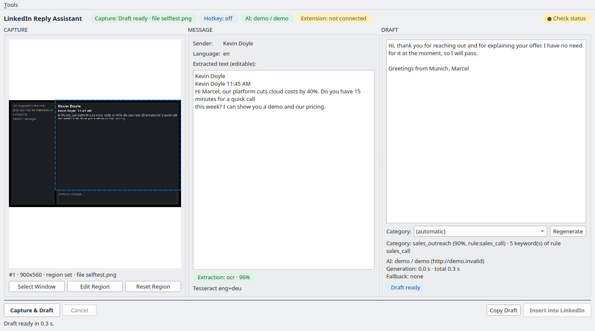
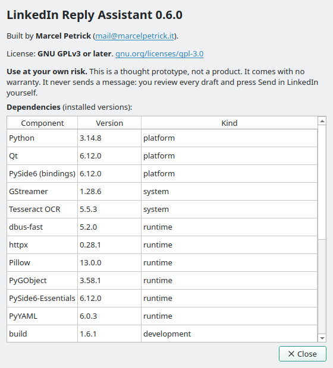
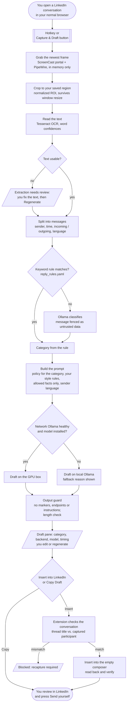

# LinkedIn Reply Assistant

[](https://github.com/marcelpetrick/codingWithGPT/actions/workflows/linkedin-reply-assistant.yml)
[](https://github.com/marcelpetrick/codingWithGPT/actions/workflows/linkedin-reply-assistant-docker.yml)
[](https://github.com/marcelpetrick/codingWithGPT/pkgs/container/linkedin-reply-assistant)
[](LICENSE)
[](https://www.python.org/)
[](https://doc.qt.io/qtforpython-6/)
[](pyproject.toml)

**A local "reply desk" for LinkedIn messages: you read, it drafts, you send.**

**Author: Marcel Petrick <mail@marcelpetrick.it>**

**License: GPLv3 or later. See [`LICENSE`](LICENSE).**

**Note: project is generated with AI. It is a thought prototype: use it at your own risk.**

## What is this project?

Answering 10–20 LinkedIn messages a day is mostly the same loop: read the message, decide what kind
it is (a friendly hello, a sales pitch, a recruiter, a meeting request), write a polite reply, paste it,
send it. This desktop app removes the repetitive part of that loop and keeps you in charge:

1. You open a conversation in your normal browser, as always.
2. You press **one hotkey** (or the **Capture & Draft** button).
3. The app takes a still image of your browser window through the Wayland screen-sharing portal,
   reads the conversation with OCR, sorts the message into a category and writes a reply that follows
   your rules, with a local LLM (Ollama on your own GPU box, local fallback).
4. You read and edit the draft, then press **Insert into LinkedIn**: a small browser extension puts
   the text into the reply box.
5. **You** press Send. The app never sends, never clicks, never browses LinkedIn on its own, and
   makes no request to linkedin.com at all.

Everything runs on your machine and your network. No cloud, no LinkedIn login in the app, no
screenshots or messages stored on disk.



**Help → About** shows the author, the license, the disclaimer and every dependency with its version:



## How it works

One press of the hotkey or the **Capture & Draft** button runs one pipeline. Every step runs in a
worker thread, checks a cancel token, and is timed. A newer capture always wins over an older one.



How the reply is prepared with Ollama:

1. **Classify.** Keyword rules from `reply_rules.yaml` handle the clear cases (sales call, lead
   generation, recruiter, congratulations) without a model call. The rest goes to the model with the
   classifier prompt; the answer is a JSON object with category, confidence and reason.
2. **Choose the policy.** Each category maps to a policy and a prompt file, for example
   `sales_outreach → sales_decline.md` (decline politely, no opening for a follow-up) or
   `recruiting → recruiting.md` (friendly, state your role preference).
3. **Build the prompt.** The system prompt holds your name, the reply language (mirrors the sender:
   English or German), the word limit, your sign-off, your style rules and the only facts the draft may
   claim (`user_profile.yaml`). The conversation goes into the user message between data markers, so
   text like "ignore all previous instructions" stays data.
4. **Generate.** The backend manager tries the network node first (`192.168.100.67`), then local
   Ollama. Health is cached, so a dead node does not stall each draft. The model answers with JSON
   (`reply`, `category`, `language`, `needs_manual_review`); only `reply` reaches LinkedIn.
5. **Check.** An output guard flags drafts that echo the data markers, a backend address or the
   instructions, and drafts far above the word limit. Flagged drafts show "Review carefully".

| Part | What it does |
|---|---|
| Capture | XDG ScreenCast portal + PipeWire. You pick the browser window once; the restore token is single-use and rotated. Frames stay in memory. |
| Hotkey | XDG GlobalShortcuts portal. The app proposes a trigger, the desktop decides. The button always works. No root, no input hooks. |
| Extraction | Tesseract (default, decision D9 in [`plan.md`](plan.md)), optional vision model or hybrid. The text is editable. Poor results show "Extraction needs review". |
| Reply | Keyword rules from `reply_rules.yaml` first, the model for the rest. Message text is fenced as untrusted data; an output guard flags drafts that echo instructions. |
| Backends | Ollama on the network node first, local Ollama second, cached health, visible fallback reason. |
| Insertion | A Manifest V3 extension (Chromium first) talks to the app through `lra-native-host` and a private Unix socket. It checks the conversation, inserts into an empty composer, reads it back. It never clicks, types keys, submits or navigates. |

## Safety rules

The tool reads your screen and writes one approved text into one composer. It makes **zero requests to
linkedin.com**, uses no LinkedIn credentials or cookies, and never sends. The full rules, including the
two documented "bent" rules, are in [`AGENTS.md`](AGENTS.md). `tests/unit/test_guard.py` fails the build
if the code contains a click, a key event, a submit, a navigation or an HTTP call to LinkedIn.

## Setup

Manjaro/Arch (the target system). Debian/Ubuntu: `sudo scripts/install_system_deps.sh` installs the same.

1. Install the system packages:

   ```bash
   sudo pacman -S --needed tesseract gst-plugin-pipewire gst-plugins-base gst-plugins-good \
     python-gobject xdg-desktop-portal uv
   ```

2. Install the app for your user (venv, Tesseract English data without root, native host, menu entry,
   self-test):

   ```bash
   scripts/install.sh
   ```

3. Load the extension: open `chromium://extensions`, enable Developer mode, press "Load unpacked" and
   select the [`extension/`](extension) directory. The extension id is fixed
   (`halpmmpcpefihaehddccolenemgembam`), so the native host manifest matches.

4. Install at least one LLM backend. The local fallback needs Ollama and one small model:

   ```bash
   sudo pacman -S --needed ollama && sudo systemctl enable --now ollama
   ollama pull qwen3.5:4b
   ```

   The network box (`192.168.100.67`) is tried first. It needs `qwen3.6:35b-a3b-q4_K_M` or
   `qwen3.8:27b-q4_K_M`. Change hosts and models in `backends.yaml` (see below).

5. Put your own facts into the profile. A draft claims only what this file lists:

   ```bash
   mkdir -p ~/.config/linkedin-reply-assistant
   cp src/linkedin_reply_assistant/defaults/user_profile.yaml ~/.config/linkedin-reply-assistant/
   ```

6. Check the system. Every line must show OK or WARN:

   ```bash
   .venv/bin/lra preflight
   ```

Configuration lives in `~/.config/linkedin-reply-assistant/`. A file there replaces the shipped default
of the same name in [`src/linkedin_reply_assistant/defaults/`](src/linkedin_reply_assistant/defaults):
`app.yaml`, `backends.yaml` (endpoints, models, timeouts), `reply_rules.yaml`, `user_profile.yaml`
(the only facts a draft may claim) and `prompts/*.md` (put your own decline prompt into
`prompts/sales_decline.md`).

## Usage

1. Start the app: `lra gui` (or the menu entry "LinkedIn Reply Assistant").
2. Press **Select Window** and pick the LinkedIn browser window in the desktop dialog.
3. Press **Capture & Draft** once, then **Edit Region** and drag a box around the conversation.
4. Optional: **Tools → Keyboard Shortcuts…** → request a global hotkey (default proposal `Ctrl+Alt+L`).
5. For each message: open the conversation in the browser, press the hotkey or **Capture & Draft**,
   check the extracted text and the draft, edit, then press **Insert into LinkedIn** (or **Copy Draft**).
6. Review the text in LinkedIn and press **Send** yourself.

| Command | Purpose |
|---|---|
| `lra gui [--demo] [--image FILE]` | The desktop app. `--demo` uses the offline demo backend, `--image` captures from a file. |
| `lra preflight` | Session, portals, PipeWire, Tesseract, extension bridge and every Ollama backend. Exit 1 on a failure. |
| `lra selftest [--live]` | Runs capture → OCR → classification → draft on a bundled image. Offline by default. |
| `lra test-window [--sample NAME] [--theme dark]` | The deterministic Capture Test Window for live portal tests without LinkedIn. |
| `lra screenshot FILE` | Renders the real main window after a demo Capture & Draft. |

In-app keys: `Ctrl+R` regenerate, `Esc` cancel, `Ctrl+E` focus the draft, `Ctrl+D` copy the draft,
`Ctrl+Q` quit. Insert has no key on purpose.

## Test and pipeline

`./localPipeline.sh` is the only quality gate. CI ([`linkedin-reply-assistant.yml`](../.github/workflows/linkedin-reply-assistant.yml))
installs the system packages and runs the same script.

| Stage | Tool | Fails when |
|---|---|---|
| install | `uv` | dependencies do not resolve |
| license headers | `grep` | a `.py`, `.sh` or `.js` file has no `SPDX-License-Identifier: GPL-3.0-or-later` |
| ruff lint / ruff format | `ruff` | a lint rule fails or a file is not formatted |
| mypy strict | `mypy --strict` | a type error exists |
| guard | `pytest` | the code contains a send, click, key event, navigation or LinkedIn call |
| pytest coverage | `pytest-cov`, `pytest-qt` | a unit/integration test fails or branch coverage < 95% |
| build / wheel smoke | `build`, clean venv | the wheel does not build, or `lra selftest` fails from the wheel |
| e2e | Playwright Chromium | the real extension + native host + bridge cannot insert into the routed fake LinkedIn page, or anything leaves the machine |
| docker | `scripts/docker_smoke.sh` | the image does not build, or `selftest` / UI render fails with `--network none` |

Test layers:

- **Unit:** config, workflow states, backend priority and health cache, OCR parsing, classifier rules,
  prompt fences, output guard, fingerprint, bridge protocol, UI with `pytest-qt` (offscreen).
- **Integration:** fake ScreenCast and GlobalShortcuts portals on a private `dbus-daemon`, GStreamer
  test sources through the real frame grabber, real Tesseract on rendered screenshot fixtures.
- **End to end:** Chromium with the extension and the native host; every request is answered by a
  Playwright route, so no byte goes to LinkedIn.
- **Live (manual):** `LIVE_OLLAMA=1 .venv/bin/pytest tests/integration/test_live_ollama.py` checks all
  message fixtures against the real models.

## Scripts

| Script | Purpose |
|---|---|
| [`localPipeline.sh`](localPipeline.sh) | Full quality gate (see above). Exit 0 = green. |
| [`scripts/commit.sh`](scripts/commit.sh) | Bump semver, run the pipeline, log the check in `plan.md`, commit, push. |
| [`scripts/bump_version.sh`](scripts/bump_version.sh) | Bump patch/minor/major in `version.py`. |
| [`scripts/install.sh`](scripts/install.sh) | User install: venv, Tesseract data, native host, desktop entry, self-test. |
| [`scripts/install_native_host.sh`](scripts/install_native_host.sh) | Register `lra-native-host` for Chromium, Chrome and Firefox. |
| [`scripts/install_system_deps.sh`](scripts/install_system_deps.sh) | Debian/Ubuntu system packages (CI, containers). |
| [`scripts/fetch_tessdata.sh`](scripts/fetch_tessdata.sh) | Tesseract language data into the user data directory. |
| [`scripts/make_ocr_fixtures.py`](scripts/make_ocr_fixtures.py) | Render the OCR screenshot fixtures from the synthetic messages. |
| [`scripts/benchmark_extractors.py`](scripts/benchmark_extractors.py) | Compare OCR and vision extraction on the fixtures (live). |
| [`scripts/docker_smoke.sh`](scripts/docker_smoke.sh) | Build the image and smoke-test it offline. |

## Docker

The image `ghcr.io/marcelpetrick/linkedin-reply-assistant` contains the full app, Tesseract (English,
German) and GStreamer with `pipewiresrc`. The default command is the offline self-test.

```bash
docker run --rm ghcr.io/marcelpetrick/linkedin-reply-assistant:latest            # lra selftest
docker run --rm ghcr.io/marcelpetrick/linkedin-reply-assistant:latest --version
```

The GUI needs the host's Wayland, D-Bus and PipeWire sockets (same user id 1000):

```bash
docker run --rm --init --user 1000 \
  -e WAYLAND_DISPLAY -e XDG_RUNTIME_DIR=/run/user/1000 -e QT_QPA_PLATFORM=wayland \
  -e DBUS_SESSION_BUS_ADDRESS=unix:path=/run/user/1000/bus \
  -v /run/user/1000:/run/user/1000 \
  -v ~/.config/linkedin-reply-assistant:/home/lra/.config/linkedin-reply-assistant \
  ghcr.io/marcelpetrick/linkedin-reply-assistant:latest gui
```

The native install (`scripts/install.sh`) is the recommended way for daily use: the portals and the
browser extension then see a normal desktop application.

## Documents

| Document | Content |
|---|---|
| [`VISION.md`](VISION.md) | The product, architecture, gates and 30 acceptance criteria |
| [`plan.md`](plan.md) | Living document: decisions, results, commit log with one check per commit, "Resume here" |
| [`AGENTS.md`](AGENTS.md) | Hard limits, bent rules with their fences, build rules |
