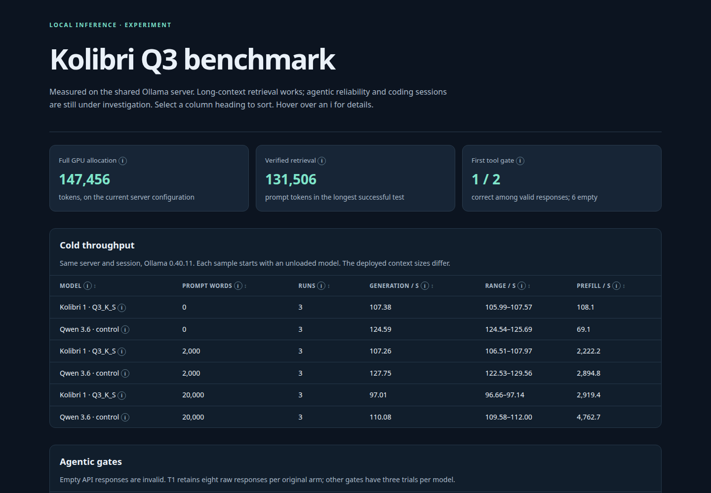

# Kolibri Q3 experiment

[](https://github.com/marcelpetrick/codingWithGPT/actions/workflows/kolibri-q3.yml)

This experiment tests Kolibri-1 Q3_K_S on the shared Ollama server. See [the run record](KOLIBRI_Q3_RUN.md) for the plan, evidence, status and resume commands. See [the vision](vision.md) for the goal.

## Use the model

The tested tag is `kolibri1:q3ks-ctx147456-nothink-ab` on `192.168.100.67:11434`. It uses a 147,456-token allocation and a corrected disabled-thinking prefix. Wait until the current benchmark is finished before sending requests.

```sh
curl --noproxy '*' -fsS http://192.168.100.67:11434/api/chat \
  -H 'Content-Type: application/json' \
  -d '{"model":"kolibri1:q3ks-ctx147456-nothink-ab","messages":[{"role":"user","content":"Hello"}],"think":false,"stream":false}'
```

The tag passes long-context retrieval. Tool-call reliability depends on the request mode and is still under test. Check the dashboard before using it as a coding agent.

## Run checks

Install Python 3, `coverage` 7.14.0, `ruff` 0.17.2 and ShellCheck. Run `./localPipeline.sh`. This checks shell syntax, ShellCheck, Python compilation and unit tests. It requires at least 95% statement coverage across `residency.py` and `refine.py`. The tests do not contact the server.

## Dashboard

Open [dashboard.html](dashboard.html) in a browser. It is generated from the result files. Select a column heading to sort. The page reloads every 60 seconds. `dashboard_watch.py` updates the result snapshot and regenerates the page when a coding result arrives. Empty final TSV fields are shown as `-` in the dashboard snapshot; raw logs stay unchanged.



## Scripts

- `pull-model.sh` checks that the server is idle and downloads the selected model. It uses `results/pull.lock` to prevent duplicate local pulls.
- `after-pull.sh` waits on the pull lock and starts the residency probe. Run it only after starting the pull.
- `speed-probe.sh` runs three cold v4 throughput samples per prompt size for each model. It waits for the retrieval stage.
- `thinking-retry.sh` repeats v4 T1 with adaptive thinking as a separate arm.
- `fidelity-retry.sh` repeats v4 T10 eight times and saves full API responses.
- `deep-probe.sh` runs the v4 multi-turn and long-context tool gates after coding sessions.
- `reasoning-arm.sh` tests the official disabled-reasoning instruction as a separate T1 arm.
- `bilingual-probe.sh` waits for the adaptive-thinking gate, then starts `bilingual.py`.
- `bilingual.py` runs paired English and German arithmetic prompts with exact-answer scoring.
- `make_dashboard.py` generates the sortable dashboard from result files.
- `dashboard_watch.py` updates the dashboard on filesystem events while the benchmark runs.
- `coding-bench.sh` runs the v4 easy and hard fixtures in the existing sandbox image. It waits for the tool battery.
- `agentic-battery.sh` runs v4 gates T2, T4, T5 and T8–T11 on both models. It waits for the near-limit test.
- `near-limit.sh` waits for completed speed tests and retries retrieval below the overflow point.
- `needle-probe.sh` runs the v4 retrieval ladder with stricter error checks.
- `gate-reliability.sh` repeats v4 T1 eight times and keeps the raw responses. It fixes a null-content crash in the copied scorer.
- `agentic-smoke.sh` runs the unchanged v4 T1 gate once at the measured context. Pass a model tag and result label to test a separate variant.
- `after-residency.sh` waits for the ladder and starts `refine.py`.
- `refine.py` searches the remaining context interval in steps of 1,024 tokens.
- `residency.py` checks the server, tests context sizes and writes `results/residency.jsonl`. It resumes matching results and refuses to unload another model.
- `localPipeline.sh` runs the local checks.
- `test_bilingual.py` checks bilingual scoring and server safety.
- `test_dashboard.py` and `test_dashboard_watch.py` check report data and live updates.
- `test_coding_patch.py` checks the copied harness patch and failing-test handling.
- `test_fixture_baseline.py` checks scoring when a model commits fixture changes.
- `test_pull.py` checks that failed preflight reads stop the pull.
- `test_refine.py` checks the context search.
- `test_residency.py` tests the probe with mocked responses and a local HTTP server.

The scripts use `192.168.100.67:11434`. Do not run them while another user occupies the server. Check `results/pull.log` and `results/chain.log` after a detached run. The probe stops on errors or the first GPU spill. A successful allocation does not establish retrieval or tool-use quality.

The experiment code is GPL-3.0-or-later. The model and upstream runtimes have separate licenses. See [LICENSE](LICENSE) and the model publisher's license.
